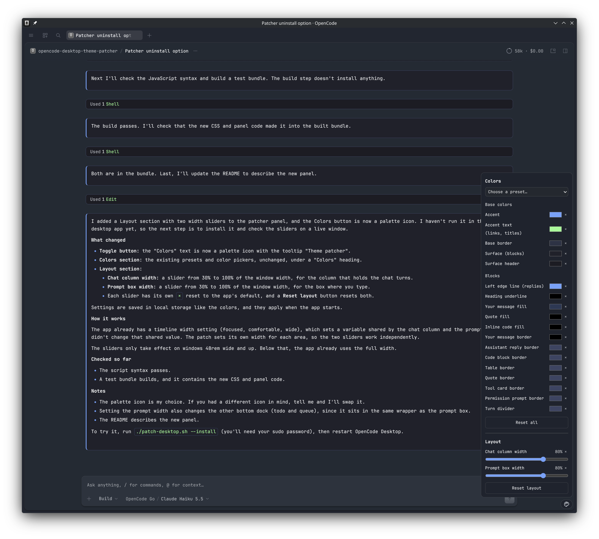
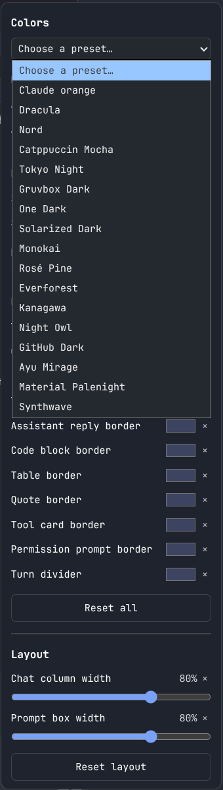
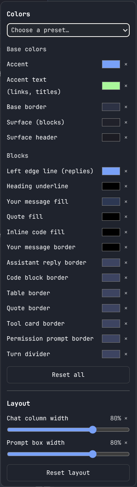

# opencode-desktop-theme-patcher

Patches the Linux **OpenCode Desktop** app with a bordered, Claude Code-style chat look, a per-element color panel, and 17 preset color schemes.

> Unofficial. This is not affiliated with or endorsed by the OpenCode project. It modifies the installed app bundle, so use it at your own risk.

## Screenshots

<p align="center">
  
</p>

<table align="center">
  <tr>
    <td align="center"><br><sub>Preset menu open</sub></td>
    <td align="center"><br><sub>Colors and Layout sections</sub></td>
  </tr>
</table>

## What it changes

- **Markdown blocks:** code blocks, tables, blockquotes, inline code, headings and horizontal rules get clear borders, rounded corners and accent colors.
- **Assistant replies:** each reply sits in a bordered box with a left edge line.
- **Your messages:** a tinted bubble with its own border and fill.
- **Tool calls and permission prompts:** bordered cards with a tinted header.
- **Turn dividers:** a line between chat turns.
- **Theme patcher panel:** a floating palette icon button (bottom-right) opens a panel with two sections:
  - **Colors**
    - 17 presets, including Dracula, Nord, Catppuccin Mocha, Tokyo Night, Gruvbox Dark, One Dark, Solarized Dark, Monokai, Rosé Pine, Everforest, Kanagawa, Night Owl, GitHub Dark, Ayu Mirage, Material Palenight, Synthwave and Claude orange.
    - A color picker for every element: accent, accent text, base border, surfaces, heading underline, your message fill and border, quote fill, inline code fill, and the border of each block type.
    - Per-color reset (`×`) and a **Reset all** button.
  - **Layout**
    - **Chat column width:** a slider (30–100% of the window width) for the column that holds the chat turns.
    - **Prompt box width:** a slider (30–100% of the window width) for the box where you type your questions.
    - Per-slider reset (`×`) returns to the app's default, and a **Reset layout** button resets both.

Colors and layout are saved in the app's local storage, so they persist between launches. Sliders only take effect on wide windows (48rem and up), where the app already limits the column width.

## Requirements

- Linux with the OpenCode Desktop package installed to `/usr/lib/opencode-desktop/` (the layout used by the Arch package).
- `node` and `npx` (the script uses `@electron/asar` through `npx`).
- `sudo` access, for the install step only.

## Usage

Clone the repo and run the script from its folder:

```bash
git clone https://github.com/ordinarylinuxuser/opencode-desktop-theme-patcher.git
cd opencode-desktop-theme-patcher
./patch-desktop.sh            # builds /tmp/opencode/app.asar.new, does not install
./patch-desktop.sh --install  # builds and installs over /usr/lib/opencode-desktop/app.asar (needs sudo)
./patch-desktop.sh --uninstall # restores the original app.asar and removes the saved state (needs sudo)
```

Then restart OpenCode Desktop and open the **Colors** panel.

### After an app update

Package updates overwrite `app.asar`. Run the script again with `--install` to re-apply the patch. The script detects the new file, saves it as the pristine copy, and patches it again.

## How it works

1. `patch-desktop.sh` saves a pristine copy of `app.asar` to `~/.local/share/opencode-desktop-theme/`.
2. It extracts the bundle to `/tmp/opencode/build`.
3. It appends `chat-blocks.css` to the app's main stylesheet.
4. It inserts `accent-switcher.js` as an inline script into `index.html`. This adds the Colors panel and applies saved colors as CSS variables.
5. It repacks the bundle, keeping the native `node-pty` module unpacked, and copies it into place when `--install` is given.

The stylesheet uses CSS variables such as `--oc-accent`, `--oc-b-user` and `--oc-f-user`. The panel sets these on the root element, so every block updates at once.

## Uninstalling

```bash
./patch-desktop.sh --uninstall
```

This copies the saved pristine `app.asar` back over `/usr/lib/opencode-desktop/app.asar` and deletes `~/.local/share/opencode-desktop-theme/`. Restart OpenCode Desktop afterward. If the pristine copy is missing, reinstall the package.

Manual equivalent:

```bash
sudo cp ~/.local/share/opencode-desktop-theme/app.asar.orig /usr/lib/opencode-desktop/app.asar
rm -rf ~/.local/share/opencode-desktop-theme
```

## Files

| File | Purpose |
| --- | --- |
| `patch-desktop.sh` | Builds and optionally installs the patched bundle. |
| `chat-blocks.css` | Block, card and border styles, driven by CSS variables. |
| `accent-switcher.js` | The Colors panel, presets and local-storage persistence. |

## Notes

- Tested on OpenCode Desktop 2.2.1 with Electron 44 on Linux (Wayland). Other versions may need selector updates, because the styles target the app's internal `data-component` and `data-slot` names.
- The `/tmp/opencode` working directory is hard-coded in the script.
- The preset palettes were written by hand from each scheme's commonly published colors. Some shades may differ slightly from the official versions.

## License

MIT. See [LICENSE](LICENSE).
